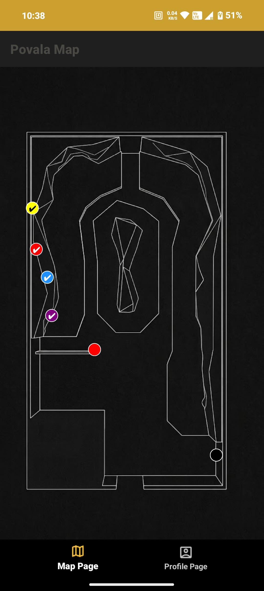
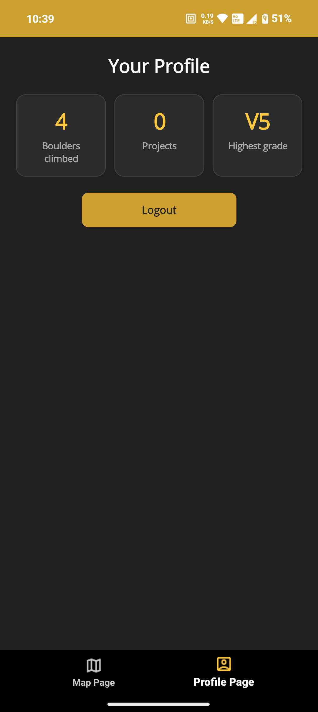
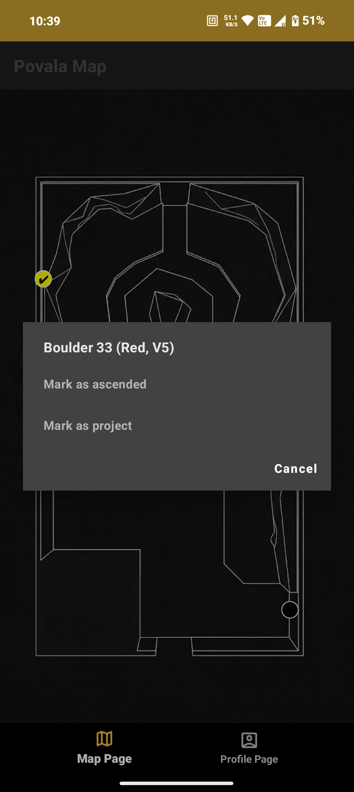
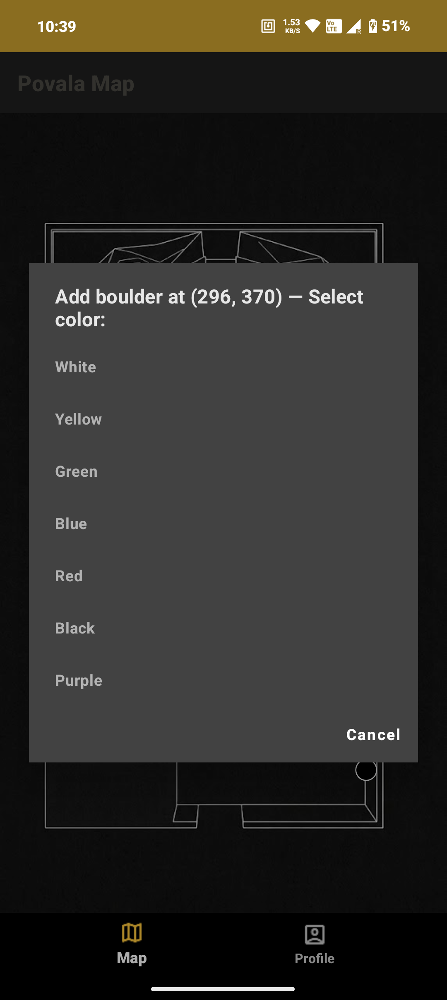
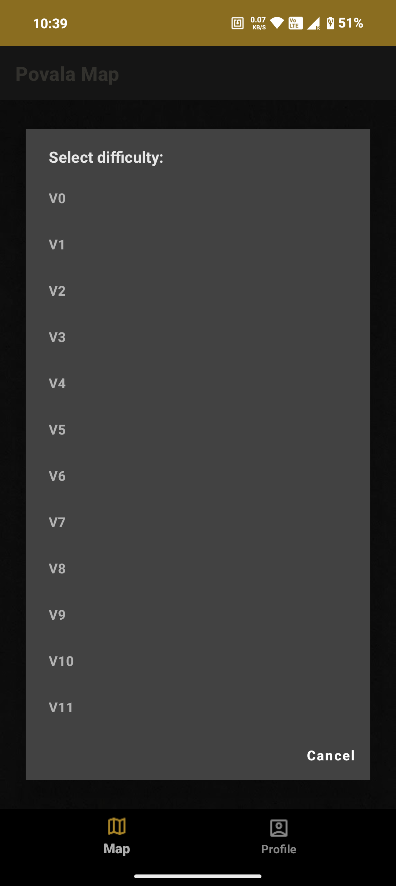

# Povala - Bouldering App

Povala is a simplified application designed for managing and navigating a single specific bouldering gym (similar to TopLogger). It consists of a backend (ASP.NET Core API) and a client application (.NET MAUI).

### User Roles
The application uses a system of two roles:
1. **Owner:** 
   - Has access to the map management interface.
   - Can add a new boulder by tapping on the map, specifying its color and difficulty (coordinates are saved automatically).
   - Can soft delete existing boulders by tapping on them.
2. **User (Climber):**
   - Has access to the standard user view (`UserShell`).
   - Can see the visual map of the gym with all current boulders.
   - Upon clicking a boulder, the user can mark it as an **Ascent** or as a **Project**.
   - Has a profile page with statistics: total boulders climbed, number of active projects and highest grade climbed.

### Screenshots

<table>
  <tr>
    <td align="center"><b>Map Page</b></td>
    <td align="center"><b>Profile Page</b></td>
    <td align="center"><b>Boulder Actions</b></td>
  </tr>
  <tr>
    <td align="center"></td>
    <td align="center"></td>
    <td align="center"></td>
  </tr>
</table>
<table>
  <tr>
    <td align="center"><b>Add Boulder - Color (Owner)</b></td>
    <td align="center"><b>Add Boulder - Difficulty (Owner)</b></td>
  </tr>
  <tr>
    <td align="center"></td>
    <td align="center"></td>
  </tr>
</table>

### Project Structure
- `Povala.Api/` - ASP.NET Core REST API. Handles data persistence (SQLite via Entity Framework Core), user authentication (Identity), and the logic for boulders, ascents, and projects.
- `povala-app/` - .NET MAUI frontend application for mobile devices and desktop, separated into modules for the Owner and regular User.
- `Povala.Shared/` - Shared library containing common constants (e.g., roles, difficulty and color enums) and DTOs (Data Transfer Objects) shared between the API and the MAUI app.

## Local Setup

### Backend (Povala.Api)
1. Navigate to the `Povala.Api` directory.
2. Run the API: `dotnet run`. The API will start on port `5058` and provide access to the endpoints and the database (`Povala.Api/povala.db`).

Database migrations are applied automatically when the API starts, so `dotnet ef database update` is no longer needed.

### Backend in Docker
Runs the API the same way it would run on a server. Requires [Docker Desktop](https://www.docker.com/products/docker-desktop/).

1. Copy `.env.example` to `.env` in the repository root and fill in the values (see the comments in the file). `.env` is git-ignored and must never be committed.
2. Stop any API started from Visual Studio or `dotnet run`, because the container uses the same port (`5058`).
3. From the repository root, build and start the container: `docker compose up --build -d`
4. Check that it started: `docker compose logs -f api` should end with `Now listening on: http://[::]:8080`.

The app connects to the container exactly like to a locally running API (port `5058`, including `adb reverse` on a physical phone).

Useful commands:
- `docker compose down` - stops and removes the container. Data is kept.
- `docker compose down -v` - also deletes the `povala-data` volume, i.e. **all data**.
- `docker compose up --build -d` - rebuild after code changes (there is no hot reload in the container).

The container uses its own database (`/app/data/povala.db` in the `povala-data` volume), not `Povala.Api/povala.db`. It runs in the `Production` environment, so the Scalar API reference is not available.

### Tests
   - To run backend unit tests, run the following command: `dotnet test Povala.Api.Tests`

### Frontend (povala-app)
1. Open the `povala-app.slnx` solution in Visual Studio.
2. Set the `povala-app` project as the "Startup project".
3. Compile and run the application on your desired emulator (Android, iOS) or as a local Windows application (Windows Machine).

